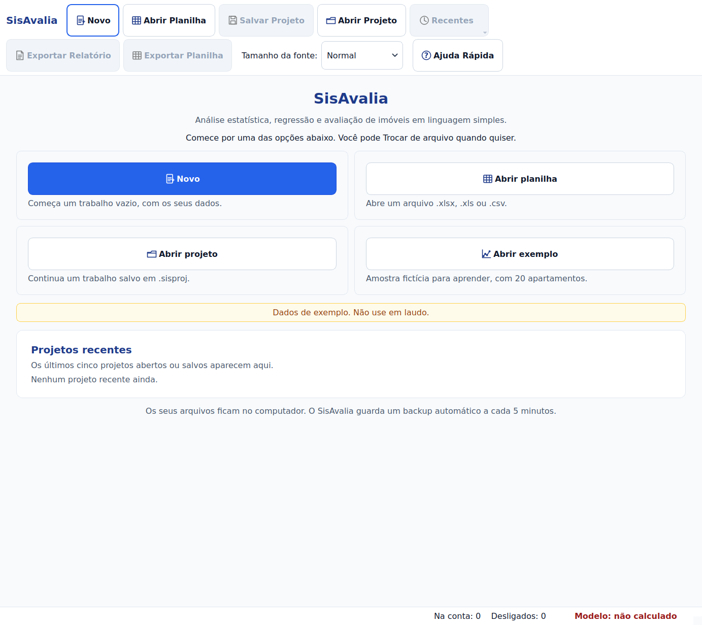

# SisAvalia

Programa desktop em português do Brasil para **análise estatística, regressão linear múltipla e engenharia de avaliações de imóveis**, inspirado no uso do SisDEA/TS-Sisreg. Feito para Linux Mint, para ser usado **sem terminal**.

> **Dados de exemplo. Não use em laudo.** A amostra que acompanha o programa é fictícia e serve apenas para aprender.



**Documentação em PDF:** [Manual do Usuário](docs/Manual_do_Usuario_SisAvalia.pdf) · [Guia de Testes de Aceitação](docs/Guia_de_Testes_SisAvalia.pdf)  
**Downloads:** [página de Releases](https://github.com/brunomendesdecarvalho/sisavalia/releases/latest)

## Instalação sem terminal

O SisAvalia é distribuído de duas formas. **O Python e as bibliotecas já vão dentro do programa**: não é preciso instalar Python no computador de destino.

### Linux Mint — arquivo `.deb` (três passos)

1. **Baixe o arquivo `sisavalia_1.2.3_amd64.deb`** (ou a versão mais nova) e guarde na pasta Downloads.
2. **Abra o arquivo com o Instalador de Pacotes do Mint**: clique duas vezes no `.deb`, confira o nome SisAvalia e clique em **Instalar**. Se o sistema pedir a senha, digite a senha do computador.
3. **Abra o SisAvalia pelo menu**: menu do Mint → **Educação** (ou busque por **SisAvalia**) → clique no ícone. O programa abre sem janela de terminal.

Depois de instalado, você também pode **clicar duas vezes em um arquivo `.sisproj`** para abrir o projeto.

### Fedora e outras distribuições — AppImage (três passos)

> **Compatibilidade do AppImage 1.2.3:** glibc **2.28 ou superior**. Funciona em Linux Mint 20/21/22, Ubuntu 20.04+, Debian 10+ e Fedora moderno. Não funciona em Ubuntu 18.04/Mint 19 (glibc 2.27). O pacote foi verificado em Debian 10 (glibc 2.28).

1. **Baixe o arquivo `SisAvalia-1.2.3-x86_64.AppImage`**.
2. Se o gerenciador de arquivos não abrir com dois cliques, clique com o botão direito → **Propriedades** → marque **Permitir execução** (ou “Executável”).
3. **Clique duas vezes no AppImage**. O programa abre como qualquer aplicativo, sem instalar Python e sem terminal.

Em algumas distribuições pode ser necessário instalar o suporte a AppImage (`libfuse2`/FUSE). Se o duplo clique não funcionar, use o **AppImageLauncher** para integrar o arquivo ao menu. O AppImage é a opção mais indicada quando você não sabe qual é a distribuição ou quando ela não usa `.deb`.

### Windows

1. Baixe `SisAvalia-1.2.3-windows-x64.zip` na página de Releases.
2. Descompacte em uma pasta.
3. Clique duas vezes em `SisAvalia.exe`. Não é preciso instalar Python.

O programa **verifica os componentes na abertura**. Se o pacote estiver incompleto, mostra uma mensagem simples; a verificação também pode ser feita por `SisAvalia --verificar-instalacao`.

O AppImage de teste também fica disponível na [página de Releases](https://github.com/brunomendesdecarvalho/sisavalia/releases/latest). Se você recebeu esta pasta já compilada, ele está em `dist/SisAvalia-1.2.3-x86_64.AppImage` (gerado em Debian 10). A soma de verificação está em `dist/SHA256SUMS.txt`.

### Por que não instalar Python no cliente

O `.deb` e o AppImage já levam o interpretador Python e todas as bibliotecas necessárias. Instalar pacotes Python automaticamente na máquina do usuário exigiria rede, permissão de administrador e poderia quebrar o Python do sistema. Por isso, o SisAvalia não executa `pip install` sozinho: ele entrega o programa pronto e confere a integridade dos componentes na abertura. Se algo estiver faltando, a mensagem orienta a reinstalar o pacote.

Instalação mais detalhada, para casos de dúvida: [docs/INSTALACAO.md](docs/INSTALACAO.md).

## O que é possível fazer

- Importar planilhas `.xlsx`, `.xls` e `.csv` ou colar uma tabela do software de planilhas de sua preferência.
- Marcar imóveis como ativos/desligados sem apagar os dados.
- Definir Y, X, tipos de variável (incluindo Código ajustado), descrição/critério da escala, transformações (x, ln(x), 1/x, x², √x) e sinal esperado.
- Checar micronumerosidade por categoria, VIF (amarelo > 5, vermelho > 10) e coerência do avaliando.
- Alternar entre IC 80% e IP 80%, calcular o intervalo admissível e arredondar valor/limites em até 1%.
- Explorar estatísticas, vazios, dispersões e histogramas.
- Calcular uma equação OLS dirigida ou pedir sugestões de equações (até 1.500 especificações completas; acima disso, busca simplificada com teto de 400 ajustes).
- Ler ANOVA, coeficientes, R², R² ajustado, correlação, aderência, curva da função e elasticidades.
- Projetar imóveis avaliandos com **IC 80%**, intervalo de predição, campo de arbítrio de ±15% e valor adotado justificado.
- Ver o enquadramento simplificado nos graus de **fundamentação** e **precisão** da NBR 14653-2, incluindo extrapolação e teto de código alocado.
- Diagnosticar normalidade, heterocedasticidade, multicolinearidade, Durbin-Watson, resíduos, Cook e Mahalanobis.
- Fazer K-médias, PCA e simulações estatísticas.
- Exportar relatório completo ou resumo de 1 página em **PDF** ou **DOCX**, e planilha **XLSX**.
- Usar plugins, com um plugin de exemplo funcional.

## Primeiro uso

1. Na tela inicial, clique em **Abrir exemplo**.
2. Leia o aviso amarelo: os dados são fictícios.
3. Vá à aba **1. Dados** e veja como as variáveis estão configuradas.
4. Na aba **3. Regressão & ANOVA**, clique em **Calcular este modelo** ou **Sugerir equações**.
5. Na aba **4. Avaliando & NBR 14653**, clique em **Incluir avaliando** e preencha os campos.
6. Confira os graus, adote um valor dentro do intervalo e clique em **Exportar Relatório**.
7. Escolha **PDF**, marque ou não **Modo resumo (1 página)** e clique em **Gerar relatório**. Ao terminar, use **OK**.

Manual completo: [docs/MANUAL_DO_USUARIO.md](docs/MANUAL_DO_USUARIO.md).

## Onde ficam os seus dados

- Projetos: onde você salvou o arquivo `.sisproj`.
- Backup automático a cada 5 minutos: `~/.local/share/SisAvalia/backups/`.
- Lista dos 5 projetos recentes e preferências: `~/.local/share/SisAvalia/config.json`.
- Detalhes técnicos de erros: `~/.local/share/SisAvalia/erros.log`.

O programa **não envia dados pela internet**. Tudo fica no seu computador.

### Tema escuro e claro

O SisAvalia mantém a interface clara e aplica uma paleta fixa. Assim os ícones e as seleções continuam legíveis mesmo que o Linux esteja no tema escuro. O seletor de arquivos também é próprio do programa, com fundo branco e seleção azul.

## Para quem vai desenvolver

Requisitos de desenvolvimento: **Python 3.11 ou 3.12**, Linux e as versões fixadas em `requirements.txt`. O build usa PySide6 6.9.3 de propósito: versões 6.10+ exigem glibc 2.34 e quebram em sistemas mais antigos.

```bash
python3.12 -m venv .venv
source .venv/bin/activate
pip install -r requirements-dev.txt
python3 main.py
```

Testes do núcleo, sem tela:

```bash
python3 tests/verificar_nucleo.py
pytest -q
```

Regenerar o manual e o guia em PDF (requer `pandoc` e LibreOffice):

```bash
python3 docs/gerar_pdfs.py
```

Gerar o pacote `.deb` (no Linux Mint/Ubuntu):

```bash
./packaging/build_deb.sh
```

Gerar um AppImage portátil (em ambiente com glibc ≤ 2.28, por exemplo Debian 10):

```bash
./packaging/build_appimage.sh
```

O build Windows é feito pelo workflow `.github/workflows/build-windows.yml` (GitHub Actions, Python 3.12/PyInstaller) e gera `SisAvalia-1.2.3-windows-x64.zip`.

Os scripts usam PyInstaller `--windowed --onedir`; o `.deb` cria atalho no menu, ícone e associação de arquivos `.sisproj`; o AppImage gera um arquivo único executável. O AppImage pode baixar o `appimagetool` na primeira compilação.

> **Compatibilidade de build:** o `.deb` deve ser gerado no Mint/Ubuntu em que será usado. Para o AppImage portátil, o build precisa de um ambiente com **glibc ≤ 2.28** (por exemplo, Debian 10) e Python 3.11/3.12 com as versões fixadas em `requirements-dev.txt`. O script `build_appimage.sh` verifica isso e falha se o ambiente for novo demais, em vez de gerar um pacote quebrado.

Documentação técnica: [docs/ARQUITETURA.md](docs/ARQUITETURA.md)  
Guia de testes de aceitação: [docs/GUIA_DE_TESTES.md](docs/GUIA_DE_TESTES.md) · [PDF](docs/Guia_de_Testes_SisAvalia.pdf)  
Testes técnicos/automatizados: [docs/GUIA_DE_TESTES_TECNICO.md](docs/GUIA_DE_TESTES_TECNICO.md)  
Manual do usuário: [docs/MANUAL_DO_USUARIO.md](docs/MANUAL_DO_USUARIO.md) · [PDF](docs/Manual_do_Usuario_SisAvalia.pdf)

## Aviso profissional

O SisAvalia é uma ferramenta de apoio. A escolha da equação, a caracterização do imóvel, a identificação dos dados, o valor adotado e a responsabilidade técnica são do avaliador. A sugestão automática de equação **não substitui o julgamento profissional** e não dispensa a leitura da NBR 14653-2.

## Licença

MIT. Veja [LICENSE](LICENSE).
