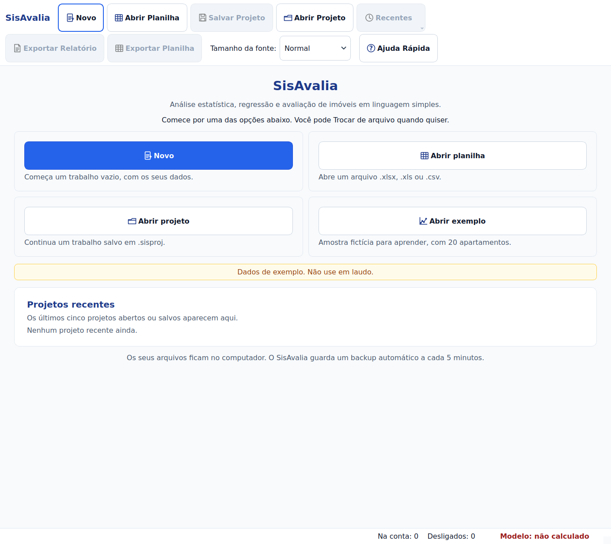
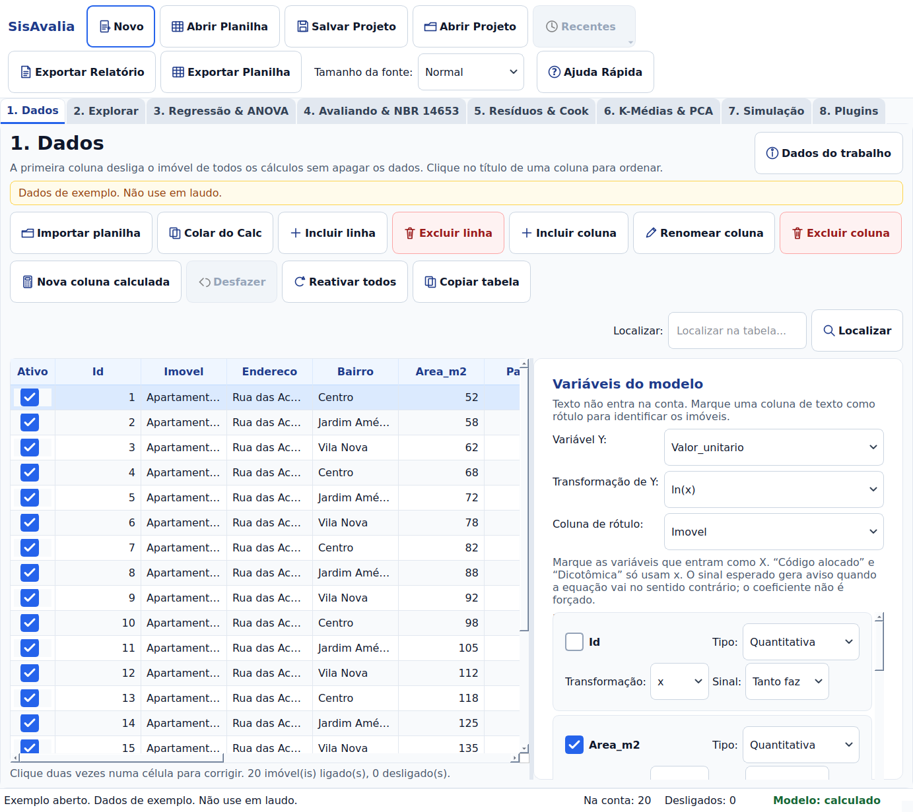
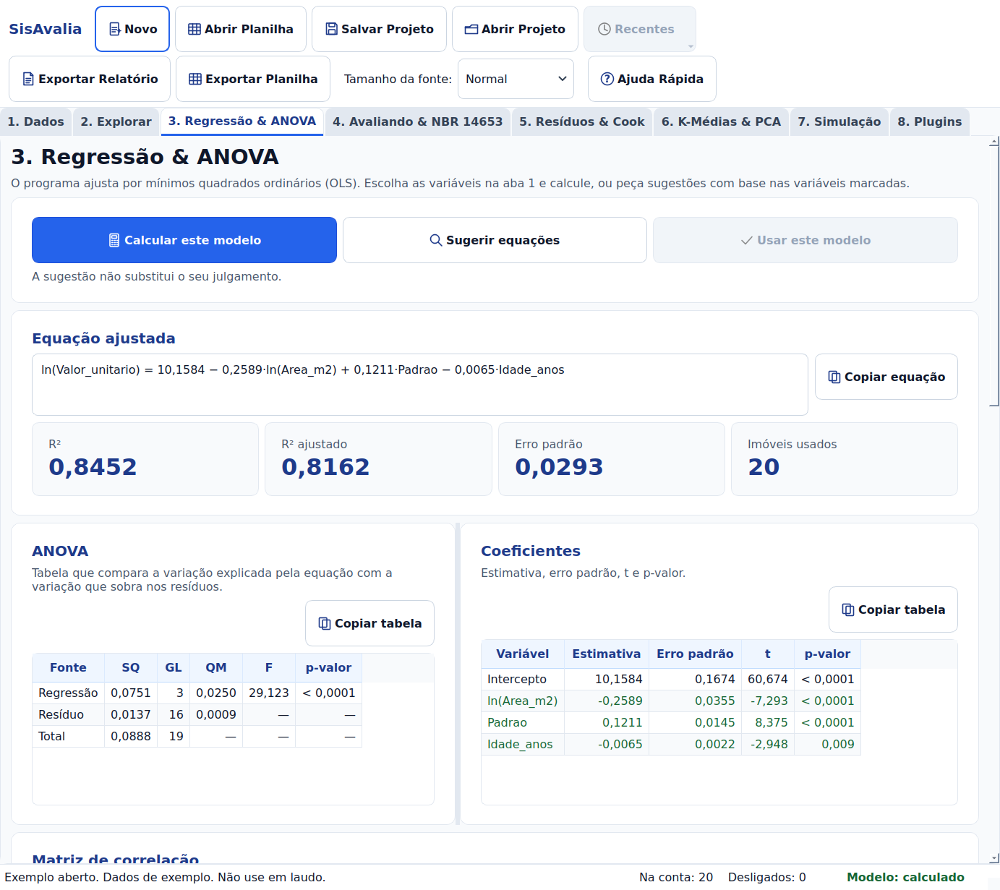
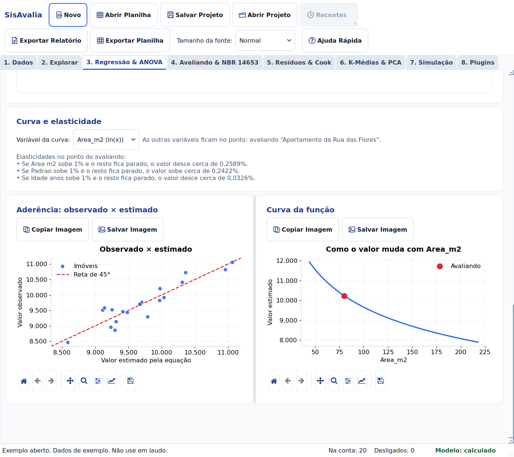
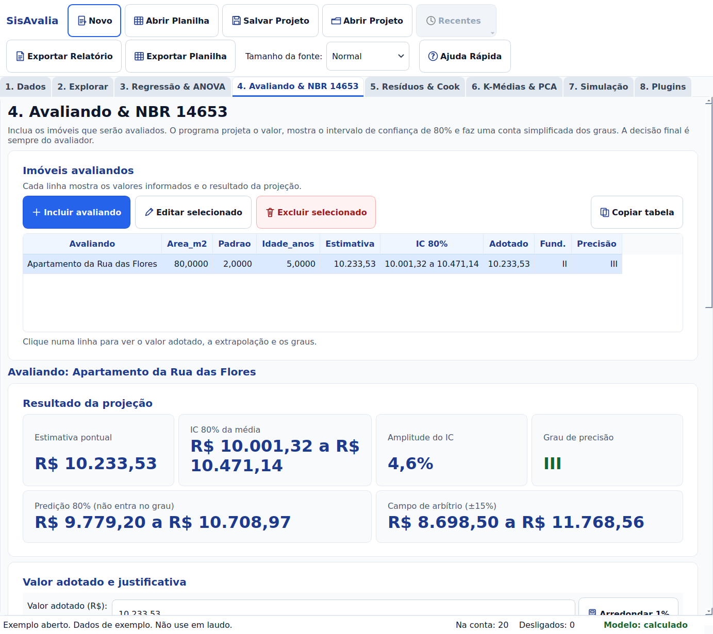
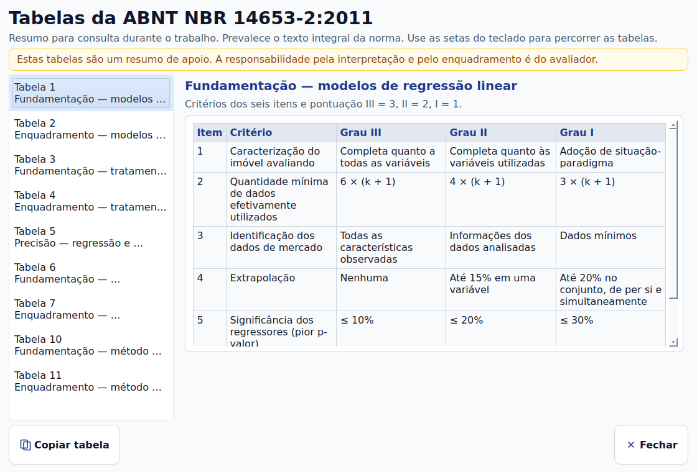
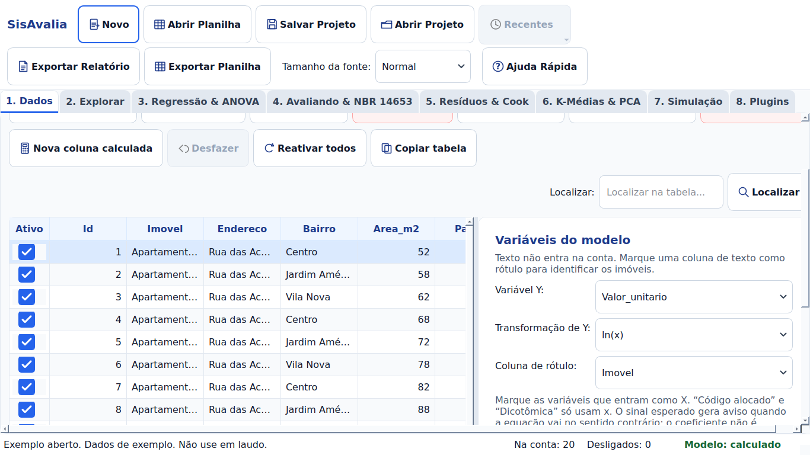

# Manual do usuário — SisAvalia

Este manual foi escrito para quem usa o programa pelo mouse e não quer lidar com programação. Todos os números aparecem no padrão brasileiro: **1.234,56**. Você pode digitar vírgula ou ponto nos campos; os dois funcionam.

> **Dados de exemplo. Não use em laudo.** A amostra de apartamentos que acompanha o programa é inventada. Ela serve para aprender o caminho das telas.

## 1. Começar



Na tela inicial há quatro caminhos:

- **Novo**: começa um trabalho vazio.
- **Abrir planilha**: abre `.xlsx`, `.xls` ou `.csv`.
- **Abrir projeto**: continua um trabalho salvo em `.sisproj`.
- **Abrir exemplo**: carrega os 20 apartamentos fictícios.

A barra superior fica sempre visível. Ela tem **Novo**, **Abrir Planilha**, **Salvar Projeto**, **Abrir Projeto**, **Recentes**, **Exportar Relatório**, **Exportar Planilha**, o seletor de **Tamanho da fonte** (Normal, Grande, Muito Grande) e **Ajuda Rápida**.

A barra de status, embaixo, mostra quantos imóveis estão na conta, quantos estão desligados e se o modelo está calculado.

### Metadados do trabalho

Na aba 1, clique em **Dados do trabalho**. Preencha autor, nome do trabalho, data, município, tipologia, descrição e, se quiser, uma observação da amostra. Esses dados aparecem no relatório.

## 2. Aba 1 — Dados



### Importar

Use **Importar planilha** ou **Abrir Planilha**. O programa reconhece:

- Excel `.xlsx` e `.xls`;
- CSV com separador `;`, `,` ou tabulação;
- vírgula ou ponto como separador decimal.

Também é possível copiar uma tabela do LibreOffice Calc (Ctrl+C) e clicar em **Colar do Calc**. Se já houver dados, o programa pergunta antes de substituir.

A primeira linha da planilha deve conter os títulos das colunas.

### Ligar e desligar imóveis

A primeira coluna da tabela é **Ativo**. Desmarque um imóvel para tirá-lo de todos os cálculos **sem apagar os dados**. O status e o modelo são atualizados na hora. Use **Reativar todos** para ligar tudo de novo.

### Editar e organizar

- Clique duas vezes numa célula para corrigir o valor.
- **Incluir linha** / **Excluir linha**.
- **Incluir coluna**, **Renomear coluna**, **Excluir coluna**.
- Clique no título de uma coluna para ordenar. A linha selecionada é preservada.
- **Localizar** procura um texto ou número na tabela.
- **Desfazer** volta a última alteração estrutural ou a última desativação em lote.
- **Copiar tabela** copia em formato TSV, pronto para colar no Calc.

### Escolher as variáveis

No painel **Variáveis do modelo**:

- **Variável Y** é o valor que a equação deve explicar.
- **Transformação de Y** pode ser x, ln(x), 1/x, x² ou √x.
- **Coluna de rótulo** é a coluna de texto que identifica o imóvel nos gráficos e nas tabelas. Exemplos: nome, endereço, inscrição.
- Marque **X** nas variáveis explicativas.
- Escolha o **Tipo** de cada variável:
  - **Quantitativa**: número medido, como área, idade e valor.
  - **Dicotômica**: dois resultados, como 0/1 ou sim/não.
  - **Código alocado**: categoria numerada, como padrão 1, 2, 3. Precisa ser inteiro a partir de 1.
  - **Código ajustado**: categoria já transformada em código por dummies, para uso como variável numérica no modelo.
  - **Proxy**: variável que substitui outra que não foi medida.
- Escolha a **Transformação** (x, ln(x), 1/x, x², √x).
- Escolha o **Sinal esperado**: Subir, Descer ou Tanto faz.
- No campo **Critério da escala / descrição**, registre o significado dos códigos. Exemplo: “1 = sem vista; 2 = vista parcial; 3 = vista para o mar”. Esse texto é guardado no projeto e incluído no laudo (NBR 14653-2, item 10.1 j).

Regras importantes:

- Colunas de texto não entram na equação. Elas podem ser usadas como rótulo.
- Dicotômica, Código alocado e Código ajustado só usam a transformação **x**.
- ln(x) e 1/x exigem todos os valores maiores que zero. √x exige valores maiores ou iguais a zero. Se não for possível, o programa avisa e não calcula.
- **Micronumerosidade**: para Dicotômica, Código alocado e Código ajustado, o programa confere cada categoria:
  - até 30 imóveis ligados: mínimo de 3 por característica;
  - de 31 a 100: mínimo de 10% do número de imóveis;
  - acima de 100: mínimo de 10 por característica.
  O alerta aparece na aba Dados, na aba 5 (Resíduos & Cook) e na aba 4 (Avaliando & NBR).

### Nova coluna calculada

Clique em **Nova coluna calculada**. Exemplo muito usado:

```text
Valor unitário = Valor total ÷ Área
```

Escolha a coluna A, a operação e a coluna B (ou uma constante). A nova coluna entra na tabela.

## 3. Aba 2 — Explorar

Mostra, para cada variável numérica dos imóveis ligados:

- mínimo, máximo, média, mediana, desvio padrão e quantidade de vazios.

No topo aparece uma faixa de alerta para vazios e para colunas de texto. Os gráficos são:

- dispersão de um X contra o Y;
- histograma de uma variável.

Quando já existe um avaliando selecionado, ele aparece como uma estrela vermelha na dispersão, para você ver a extrapolação com os olhos.

**Copiar Imagem** e **Salvar Imagem** funcionam em todos os gráficos. A imagem salva em PNG tem 240 dpi.

## 4. Aba 3 — Regressão & ANOVA



### Calcular este modelo

Ajusta a equação com as variáveis e transformações que você escolheu na aba 1, usando somente imóveis ligados. Se faltar algum valor em Y ou X, o imóvel sai apenas daquele cálculo (exclusão pela lista completa) e o programa diz quantos saíram.

Enquanto o modelo é calculado, aparece uma janela de progresso com a mensagem **Calculando o modelo... Aguarde.** Ela fecha sozinha ao terminar. Se você incluir ou retirar uma variável, o recálculo também mostra essa janela.

### Sugerir equações

Testa combinações de variáveis marcadas como X e transformações **x, ln(x) e 1/x**. Dicotômica e Código alocado entram só como x. Transformações impossíveis são puladas.

- Até 1.500 especificações: testa todas as combinações não vazias.
- Acima disso: faz uma busca simplificada (forward por teste F parcial e depois transformações das variáveis mantidas), com teto de 400 ajustes.
- A barra de progresso pode ser cancelada.
- Ficam guardadas as **30 melhores pelo R² ajustado**.

A tabela mostra equação curta, R², R² ajustado, p do F, pior p dos regressores, sinais (ok ou invertido), n e grau estimado. Clique numa linha e depois em **Usar este modelo** para levar a equação para a aba 1 e recalcular.

> **A sugestão não substitui o seu julgamento.**

### Resultados

- **Equação** em texto copiável, com os coeficientes na escala de leitura.
- **R²**, **R² ajustado** e **erro padrão** em destaque.
- Aviso quando R² < 0,75.
- **ANOVA** completa (SQ, GL, QM, F, p).
- **Coeficientes** (estimativa, erro padrão, t, p-valor).
- **Matriz de correlação**, com pares |r| > 0,80 destacados.
- **Alerta de sinal invertido**, sem forçar o coeficiente.
- **Aderência observado × estimado** com reta de 45° e rótulo ao apontar.
- **Curva da função** para uma variável, com as outras presas no avaliando selecionado ou na média.
- **Elasticidades**: “se Área sobe 1% e o resto fica parado, o valor cai cerca de 0,35%”. Para dicotômica, mostra a diferença percentual entre os dois códigos.



O teste t dos itens de fundamentação usa **somente os regressores**, nunca o intercepto.

## 5. Aba 4 — Avaliando & NBR 14653



### Incluir avaliandos

Clique em **Incluir avaliando**. Dê um nome e preencha um campo para cada X. Repita para quantos imóveis quiser. A linha selecionada alimenta os gráficos e os painéis.

### Resultado de cada avaliando

Na escala original de Y:

- **Estimativa pontual**.
- **IC 80% da média**, calculado com t bicaudal e n − k − 1 graus de liberdade. A amplitude é `(limite superior − inferior) / estimativa × 100`.
- **Grau de precisão**: III até 30%, II até 40%, I até 50%; acima disso, Fora de norma.
- **Intervalo de predição 80%**, visível, com o aviso de que **não entra no grau**.
- **Intervalo usado**: escolha entre **IC 80% (média)** e **IP 80% (preço)** para limitar o valor adotado.
- **Intervalo admissível**: interseção entre o intervalo escolhido e o campo de arbítrio de ±15%. É esse intervalo que mostra onde o valor final pode ficar.
- **Arredondar também os limites em até 1%**: opcional, para o laudo.
- **Campo de arbítrio de ±15%**.
- **Valor adotado** e **Justificativa**. Use **Arredondar 1%** se quiser.

O campo do valor adotado fica vermelho e explica o motivo quando:

- o valor sai do intervalo de confiança; ou
- a caixa “Usar campo de arbítrio” está marcada e o valor sai de ±15%.

Se o valor adotado for diferente da estimativa, a justificativa é **obrigatória para exportar o relatório**.

### Extrapolação

A tabela mostra, por variável, o valor do avaliando, o mínimo e o máximo da amostra ativa e a situação (dentro, acima, abaixo).

- Fora da amostra, ainda é aceitável para os graus I e II se não passar do **dobro do máximo** e não ficar abaixo da **metade do mínimo**.
- Se o mínimo amostral for zero ou negativo, a regra da metade **não é aplicada**: o programa avisa e o item 4 não recebe grau.
- **Afastamento de fronteira**: o programa recoloca a variável no limite mais próximo, recalcula e mede a diferença percentual. Para o Grau I, repete com todas as variáveis extrapoladas ao mesmo tempo.

### Graus

Itens automáticos:

| Item | O que verifica | Limites |
|---|---|---|
| 2 | Amostra efetiva | n ≥ 6(k+1) III; ≥ 4(k+1) II; ≥ 3(k+1) I; abaixo disso, 0 |
| 4 | Extrapolação | III sem extrapolação; II uma variável, afastamento ≤ 15%; I todas, cada uma ≤ 20% e simultâneo ≤ 20%; senão 0 |
| 5 | Significância das variáveis | pior p ≤ 10% III; ≤ 20% II; ≤ 30% I |
| 6 | Significância do modelo | p do F ≤ 1% III; ≤ 2% II; ≤ 5% I |

Itens manuais:

- **Item 1 — Caracterização do avaliando**: III descrição completa e conferida; II descrição razoável; I descrição mínima.
- **Item 3 — Identificação dos dados de mercado**: III dados bem identificados e verificados; II dados identificados; I dados mínimos.

Pontos: III = 3, II = 2, I = 1.

Enquadramento: o programa aplica as somas e mínimos exigidos. Se houver **Código alocado** entre as independentes, o grau final fica no máximo em **II**, com explicação.

O **grau de fundamentação** e o **grau de precisão** aparecem separados, com semáforo e pontuação.

## 6. Aba 5 — Resíduos & Cook

### Semáforo das premissas

- **Normalidade**: conta os resíduos padronizados dentro de ±1σ, ±1,64σ e ±1,96σ. As faixas esperadas são 66–74%, 85–95% e 95–100%. Verde quando dentro; amarelo quando sai até 5 pontos; vermelho no restante. O Shapiro-Wilk aparece como linha extra, sem cor decisiva.
- **Dispersão dos resíduos**: Breusch-Pagan, com frase de resultado.
- **Variáveis repetidas**: VIF amarelo acima de 5 e vermelho acima de 10; pares de X com |r| > 0,80. Quando houver redundância, o programa sugere revisar variáveis repetidas, ampliar a amostra ou consultar a aba 6 (PCA).
- **Durbin-Watson**: calculado após ordenar os imóveis pelos valores ajustados. É informativo. **Este número vale para dados ao longo do tempo. Em avaliação de imóveis ele não decide o grau.**
- **Coerência do avaliando**: o programa calcula a distância de Mahalanobis do avaliando em relação à amostra e avisa quando a combinação de X é atípica.

### Tabela

Mostra, por imóvel: rótulo, observado, estimado, resíduo, resíduo relativo, padronizado, studentizado, Cook e Mahalanobis.

- Resíduo relativo ≥ 40%: amarelo.
- ≥ 70%: vermelho.
- |z| > 2: destaque.

### Gráficos

Resíduos × ajustados, Q-Q, histograma, hastes de Cook e hastes de Mahalanobis. Todos têm **Copiar Imagem** e **Salvar Imagem**, e mostram o rótulo ao apontar o ponto.

A **roda do mouse** rola a página quando o ponteiro está sobre um gráfico. Para interagir com o gráfico, clique nele; clique fora para voltar ao modo de rolagem normal.

O Mahalanobis é calculado sobre as independentes na forma usada no modelo. O corte de 5% usa a distribuição Beta exata. Se a amostra for pequena demais, usa qui-quadrado e avisa na tela.

Os botões **Desativar pontos influentes (Cook)** e **Desativar pontos atípicos (Mahalanobis)** dizem quantos imóveis serão desmarcados na aba 1 antes de confirmar.

## 7. Aba 6 — K-Médias & PCA

Marque duas ou mais variáveis numéricas.

- **K-médias**: padronização opcional, escolha de K, gráfico 2D, cotovelo e **Gravar coluna Cluster**. A coluna entra na tabela; imóveis que não participaram ficam sem grupo.
- **PCA**: sempre com padronização, scree plot, cargas e biplot PC1 × PC2.

Todos os gráficos podem ser copiados e salvos em PNG.

## 8. Aba 7 — Simulação

Distribuições: normal, uniforme, triangular, exponencial e Poisson.

- Preencha os parâmetros em linguagem comum e o tamanho N.
- Veja histograma e estatísticas.
- Exporte em `.csv` (separador `;`, decimal vírgula) ou `.xlsx`.
- **Carregar como dados ativos** pergunta antes de substituir a amostra.

Os valores são fictícios. Não use em laudo.

## 9. Aba 8 — Plugins

O programa procura plugins na pasta `plugins` da instalação, na pasta de plugins do usuário e em todas as pastas extras que você configurar. Os plugins nativos:

- **Resumo estatístico**: mínimo, máximo, média, mediana, desvio padrão e vazios das colunas numéricas.
- **Tratamento por fatores**: homogeneização por fatores manuais, saneamento de discrepantes, coeficiente de variação e enquadramento nas Tabelas 3, 4 e 5.
- **Método evolutivo e CUB**: área equivalente, custo de reprodução, depreciação Ross-Heidecke simplificada, custo de reedição e valor evolutivo.
- **Procedimentos específicos**: liquidação forçada por VPL, desapropriação parcial antes/depois e aluguel por remuneração do capital.
- **Rede neural (MLP)**: treina uma rede de múltiplas camadas com camadas ocultas, ativação, solver, alpha, taxa de aprendizado, agenda, épocas, parada antecipada, validação, teste, padronização e semente configuráveis. Mostra R², MAE, RMSE, MAPE, comparação com a regressão linear, curva de perda e gráfico observado × previsto. É apoio exploratório; não gera grau da NBR.

Cada plugin tem botão para copiar ou salvar o resultado. Se um plugin falhar, o programa mostra uma mensagem simples e guarda o detalhe em `erros.log`.

## 10. Salvar, recuperar e exportar

### Projeto `.sisproj`

**Salvar Projeto** guarda tudo: metadados, dados, linhas ativas, tipos, rótulo, Y, X, transformações, sinais, avaliandos, valores adotados, justificativas, itens manuais, última equação e sugestões guardadas.

**Recentes** mostra os últimos cinco projetos. Se o arquivo tiver sido movido, o item aparece desabilitado.

### Backup automático

A cada 5 minutos, se houver alteração não salva, o programa grava um backup em:

```text
~/.local/share/SisAvalia/backups/
```

Se o computador desligar ou o programa fechar de forma abrupta, ao abrir aparece:

> Encontramos um trabalho não salvo da última vez. Deseja recuperá-lo?

Se você aceitar, o trabalho volta. Depois use **Salvar Projeto** para guardar em um arquivo definitivo.

Se você fechar normalmente, o backup é removido. Ao fechar com alteração não salva, o programa pergunta se quer salvar.

### Relatório

Clique em **Exportar Relatório**. Escolha:

- título que aparecerá no relatório;
- formato **PDF** ou **DOCX**;
- **Modo resumo (1 página)**;
- onde guardar.

O relatório completo traz metadados, amostra, equação, ANOVA, coeficientes, projeção de cada avaliando, IC, predição, arbítrio, valor adotado, justificativa, fundamentação, precisão, extrapolação, premissas, tabela de resíduos e gráficos.

O **PDF** mantém a sequência de dados do programa e usa margens ABNT (3 cm no topo e à esquerda, 2 cm à direita e embaixo), fonte maior, entrelinha 1,5 e texto justificado. Os gráficos são dimensionados para não cortar rótulos.

O **DOCX** é um laudo completo no esqueleto da NBR 14653-2, seção 10.1, com capa, resumo executivo, sumário e os tópicos:

1. identificação do solicitante (10.1 a);
2. finalidade (10.1 b);
3. objetivo (10.1 c);
4. pressupostos, ressalvas e fatores limitantes (10.1 d);
5. identificação e caracterização do imóvel avaliando (10.1 e);
6. diagnóstico do mercado (10.1 f);
7. métodos e procedimentos (10.1 g);
8. especificação da avaliação (10.1 h);
9. planilha dos dados utilizados (10.1 i);
10. variáveis do modelo e critérios (10.1 j);
11. tratamento dos dados e resultado (10.1 k);
12. resultado da avaliação e data de referência (10.1 l);
13. qualificação legal e assinatura (10.1 m);
14. referências;
15. anexos.

O DOCX usa A4, margens 3/2 cm, Arial 12, entrelinha 1,5, texto justificado, recuo de primeira linha e número de página no alto à direita. Tópicos sem dado ficam com o título e a indicação **Não informado. Preencher no laudo.**; Referências e Anexos já saem com um esqueleto de exemplo para você completar.

O resumo traz equação, estimativa, IC, valor adotado, graus e gráfico de aderência em uma página.

Se Y estiver em logaritmo, o relatório registra: **a estimativa é o exponencial do ajustado, sem correção de retransformação (smearing)**.

Ao terminar, o programa oferece **Abrir arquivo agora**.

### Planilha

**Exportar Planilha** gera um `.xlsx` com os dados originais, a coluna Ativo, o rótulo, estimado, resíduos, Cook, Mahalanobis, cluster (se existir) e uma aba **Avaliandos**.

### Dados do laudo

Antes de exportar, clique em **Dados do trabalho** e preencha:

- autor e responsável técnico (nome e CREA/CAU);
- solicitante, finalidade e objetivo;
- data do trabalho e data de referência;
- identificação/caracterização e diagnóstico de mercado;
- pressupostos, ressalvas e condições limitantes (há a opção rápida **Sem vistoria interna — situação-paradigma**);
- cidade da assinatura.

O relatório mostra esses campos, a equação na forma original de Y, a descrição/critério das variáveis, o gráfico Observados × Estimados, a tabela de elasticidades e o bloco de assinatura.

## 11. Teclado e acessibilidade

- Use **Tab** para andar entre os campos.
- **Enter** confirma o botão principal dos diálogos.
- **Espaço** marca/desmarca caixas e aciona botões focados.
- **F1** abre a Ajuda Rápida.
- **Ctrl+N**, **Ctrl+O** e **Ctrl+S** criam, abrem e salvam.
- O seletor **Tamanho da fonte** no topo tem Normal (12 pt), Grande (14 pt) e Muito Grande (16 pt). A escolha fica guardada.
- Passe o mouse sobre termos técnicos para ver explicações em linguagem simples.
- Em **Ajuda Rápida → Tabelas NBR 14653-2**, consulte as Tabelas 1, 2, 3, 4, 5, 6, 7, 10 e 11 com os critérios, graus e pontos. As tabelas podem ser copiadas.



## 12. Se algo der errado

- O programa nunca mostra “traceback”. Ele mostra uma mensagem curta.
- O detalhe técnico fica em `~/.local/share/SisAvalia/erros.log`.
- Se o programa não abrir, confira se o pacote foi instalado pelo Instalador de Pacotes e tente abrir pelo menu.
- Se um arquivo `.sisproj` não abrir, ele pode estar danificado. O backup automático pode ter a versão anterior.

## 13. Dependências e instalação

Se você recebeu o `.deb` ou o AppImage, **não precisa instalar Python**. O programa já vem com tudo o que usa. O SisAvalia verifica os componentes ao abrir e avisa se o pacote estiver incompleto.

O AppImage 1.2.2 é compatível com **glibc 2.28 ou superior** (Linux Mint 20/21/22, Ubuntu 20.04+, Debian 10+). Sistemas muito antigos, como Ubuntu 18.04 ou Mint 19, precisam de uma versão específica.

Para **Windows**, baixe o ZIP da release, descompacte e clique duas vezes em `SisAvalia.exe`. Não é preciso instalar Python.

O programa não baixa nem instala bibliotecas sozinho no seu computador. Isso evita pedir senha, gastar internet sem aviso ou mexer no Python do sistema. Se aparecer “Instalação incompleta”, feche e instale novamente o pacote.

## 14. Telas pequenas e tema

Em notebooks com tela de **1366 × 768** ou menor, a aba **1. Dados** passa a ter rolagem vertical. Use a barra de rolagem à direita para chegar ao painel **Variáveis do modelo** e à lista de variáveis. Os campos não ficam mais sobrepostos.

O menu superior e as abas continuam acessíveis. Se a fonte estiver em **Grande** ou **Muito Grande**, a janela pode precisar de mais largura; nesse caso, aumente a janela ou volte para **Normal**.



## 15. Limites do programa

O SisAvalia faz **OLS** (mínimos quadrados ordinários) com uma equação linear. Não faz regressão não linear, DEA, redes neurais, Box-Cox, PRESS, coeficiente forçado, senha no arquivo nem máxima verossimilhança separada. O tratamento por fatores é feito no plugin próprio, como apoio; a decisão e a responsabilidade continuam do avaliador.

A conta da NBR 14653-2 é uma **ferramenta de apoio**. Ela não substitui a análise e a responsabilidade do avaliador.
